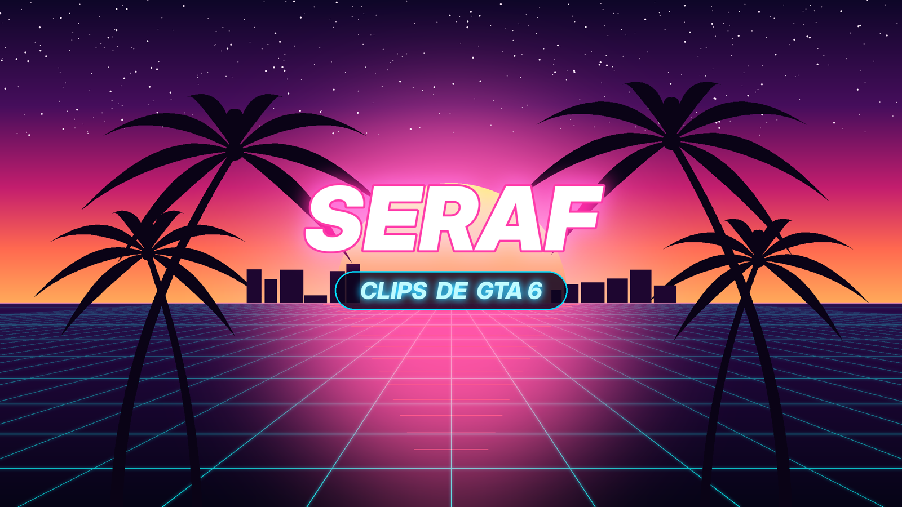

  

<h1 align="center">Hola, soy Jhoiy 👋</h1>

  Fundador de <b>Seraf Clips</b> · Colombia 🇨🇴 
  <i>«Tú solo transmites. Nosotros hacemos el resto.»</i>

  

<a href="#english">🇺🇸 English below</a>

---

## 🎬 Seraf Clips

**Seraf Clips** es una agencia de clips para streamers de **GTA 6**: *tu equipo detrás del stream*.

Mientras el streamer está en directo, nosotros encontramos sus mejores momentos, los cortamos,
los pasamos a vertical con su cámara en alta resolución y los dejamos listos para **TikTok,
Reels y Shorts**. Trabajamos con streamers de Kick, Twitch y YouTube en **España, Latinoamérica
y Estados Unidos**.

- ✂️ Clips de los mejores momentos de cada directo
- 📱 Formato vertical con la cámara arriba y el juego abajo
- 🔍 Cámara nítida, sin pixelar, mejorada con IA
- 💬 Subtítulos y edición con gancho
- 📦 Entrega diaria en la carpeta de cada streamer

---

## 🛠️ Lo que he construido

Para que un equipo pequeño pueda trabajar como uno grande, creé mis propias herramientas en macOS:

| Herramienta | Qué hace |
|---|---|
| ⌨️ **Clipeo con teclas** | Graba el directo de la pestaña abierta y corta el clip con un atajo de teclado, en vivo o desde un VOD. |
| 🤖 **IA de cámara** | Mejora la cámara del streamer con la IA de escalado de Apple: la agranda ×4 con más detalle. Funciona en cola, en segundo plano. |
| 📐 **Vertical automático** | Monta el formato 1080×1920 (cámara arriba, juego abajo) con un encuadre guardado para cada streamer. |
| 💬 **Subtítulos automáticos** | Transcribe el audio con IA en el propio Mac y quema los subtítulos en el video. |
| 🔎 **Buscador de clips** | Analiza un VOD completo (volumen, chat y transcripción) y propone los mejores momentos. |
| 📄 **Seraf Acuerdos** | App de Mac que genera el acuerdo de servicio de cada cliente en PDF con el diseño de la marca. |
| 📊 **Gestión de clientes** | Planes, renovaciones, entregas diarias y mensajes, todo desde la Terminal. |

Hecho con Swift, Python, zsh y ffmpeg, con ayuda de Claude.

---

## 🇺🇸 English

### Hi, I'm Jhoiy 👋

Founder of **Seraf Clips** · Colombia 🇨🇴 · *"You just stream. We handle the rest."*

**Seraf Clips** is a clipping agency for **GTA 6 streamers**: *your team behind the stream*.

While the streamer is live, we find their best moments, cut them, turn them into vertical
videos with a high-resolution facecam, and get them ready for **TikTok, Reels and Shorts**.
We work with Kick, Twitch and YouTube streamers in **Spain, Latin America and the US**.

- ✂️ Clips of the best moments of every stream
- 📱 Vertical format: facecam on top, gameplay below
- 🔍 Sharp, AI-enhanced facecam, no pixelation
- 💬 Captions and hook-driven editing
- 📦 Daily delivery to each streamer's folder

### 🛠️ What I've built

To let a small team work like a big one, I built my own macOS tools:

| Tool | What it does |
|---|---|
| ⌨️ **Hotkey clipping** | Records the live stream in the open tab and cuts a clip with a keyboard shortcut, live or from a VOD. |
| 🤖 **AI facecam** | Upscales the streamer's camera ×4 with Apple's AI super-resolution, in a background queue. |
| 📐 **Auto vertical** | Builds the 1080×1920 layout (camera on top, game below) from a saved crop per streamer. |
| 💬 **Auto captions** | Transcribes the audio with on-device AI and burns the captions into the video. |
| 🔎 **Clip finder** | Scans a full VOD (volume, chat and transcript) and suggests the best moments. |
| 📄 **Seraf Acuerdos** | Mac app that creates each client's branded service agreement as a PDF. |
| 📊 **Client management** | Plans, renewals, daily deliveries and messages, all from the Terminal. |

Built with Swift, Python, zsh and ffmpeg, with help from Claude.
